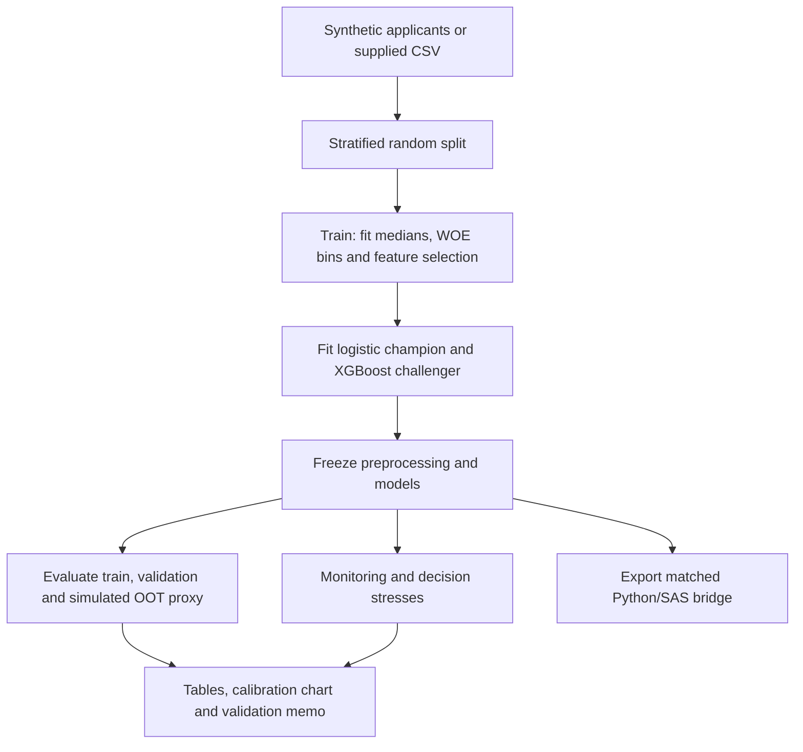

# Credit Risk

An interpretable credit risk scorecard with a challenger model and a reproducible validation workflow. The project combines Weight of Evidence (WOE) binning, logistic regression, XGBoost, calibration analysis, monitoring simulations, decision stress tests, and a Python–SAS reconciliation bridge.

The main entry point, `validate.py`, runs without downloading a dataset or installing SAS. It generates artificial applicants, fits both models, evaluates three partitions, exercises monitoring alerts, and writes a validation memo.

**Current evidence:** the committed results use 12,000 synthetic applicants. No real borrower dataset or SAS runtime was available. The random holdout is a **simulated OOT proxy**, not a genuine out-of-time test, and does not demonstrate temporal stability. Actual Python–SAS agreement remains unverified.

## Contents

- [What the project does](#what-the-project-does)
- [Quick start](#quick-start)
- [Workflow and methodology](#workflow-and-methodology)
- [Synthetic demonstration results](#synthetic-demonstration-results)
- [Monitoring simulation](#monitoring-simulation)
- [Decision stress tests](#decision-stress-tests)
- [Run with your own data](#run-with-your-own-data)
- [Train and score applicants](#train-and-score-applicants)
- [Python–SAS reconciliation](#pythonsas-reconciliation)
- [Configuration](#configuration)
- [Outputs and reproducibility](#outputs-and-reproducibility)
- [Project structure](#project-structure)
- [Verification](#verification)
- [Limitations and next steps](#limitations-and-next-steps)
- [Troubleshooting](#troubleshooting)
- [Attribution and licensing](#attribution-and-licensing)

## What the project does

| Component | Implementation |
| --- | --- |
| Data preparation | Fixed outlier caps and medians learned from training rows only |
| Feature engineering | Training-fitted WOE bins, monotonicity merging, and Information Value filtering |
| Champion | L2-regularized logistic regression on selected WOE features |
| Challenger | XGBoost on capped, imputed numeric features |
| Independent metric calculation | AUC, Gini, KS, Brier score, log loss, calibration regression, and reliability bands |
| Stability monitoring | Score PSI, Gini degradation, and mean-PD calibration-gap alerts |
| Policy sensitivity | Income and delinquency perturbations with approval and expected-default-rate reporting |
| Sign review | WOE coefficient review and applicant-level directional checks |
| Cross-platform preparation | Matched samples and design matrix for an unpenalized Python/SAS logistic comparison |
| Documentation | Generated validation memo, model card, reproducibility metadata, and verification notes |

Here, “independent” means metrics are recomputed from predictions in a separate validation module. It does not mean that a separate organization or independent real-world dataset has validated the model.

## Quick start

Use **Python 3.12** for the tested environment. The validation workflow is documented for Python 3.10–3.12; exact packages used for the committed run are recorded in [requirements-validation-lock.txt](requirements-validation-lock.txt).

```bash
git clone https://github.com/oki-dokii/Credit-Risk.git
cd Credit-Risk

python -m venv .venv
source .venv/bin/activate
python -m pip install -r requirements-validation.txt

python validate.py
python -m unittest discover -s tests -v
```

On Windows PowerShell, activate the environment with `.venv\Scripts\Activate.ps1` instead of the `source` command.

For the exact recorded package versions, install `requirements-validation-lock.txt` in place of `requirements-validation.txt`.

A successful demonstration prints the output directory, identifies the data as synthetic, reports SAS as pending, and confirms that both required monitoring alarms triggered. Start with the generated [validation memo](outputs/validation/validation_memo.md).

Useful variations:

```bash
# Fit only the logistic champion; still export the SAS bridge.
python validate.py --skip-challenger --output outputs/logistic_demo

# Change the synthetic sample size and data-generation seed.
python validate.py --rows 20000 --seed 123 --output outputs/demo_seed123

# Use a separate validation configuration.
python validate.py --config validation_config.yaml --output outputs/custom_demo

# Inspect all command-line options.
python validate.py --help
```

The generator requires at least 1,000 rows. `--seed` controls synthetic data generation; the split seed is configured separately in `validation_config.yaml`.

## Workflow and methodology



### Splitting and leakage controls

The default validation configuration uses 60% training, 20% validation, and 20% simulated OOT proxy. With 12,000 applicants, these contain 7,200, 2,400, and 2,400 observations respectively. Splits are stratified on the default indicator and have no overlapping rows.

The raw observations are split before learning missing-value medians. Training medians, WOE cut points, WOE values, Information Value selection, and fitted model parameters are then reused without refitting on either held-out partition. Outlier caps are predefined rules in `src/data_utils.py`.

**Why the OOT label is qualified:** a random sample from the same population has no date-based separation. It cannot evaluate future application vintages, changing economic conditions, outcome maturation, or temporal drift. Genuine OOT validation requires dated applications with fully observed outcomes, evaluated after the model-development cutoff.

### WOE and scorecard conventions

The target convention is `1 = default` and `0 = non-default`. WOE is calculated as:

```text
WOE(bin) = log(event distribution in bin / non-event distribution in bin)
Gini     = 2 × AUC − 1
Factor   = PDO / log(2)
Offset   = Base score − Factor × log(Base good:bad odds)
Score    = Offset + Factor × log((1 − PD) / PD)
```

Higher scorecard points mean lower predicted risk. Default scaling uses PDO 20, base score 600, and base good:bad odds 30:1. Model scores are rounded to integers and clipped to 300–850.

Positive WOE coefficients are generally consistent with the event/non-event convention. Negative coefficients and unexpected perturbation directions are flagged for review; coefficients are not automatically reversed.

### Discrimination and calibration

| Measure | What it assesses |
| --- | --- |
| AUC | Ranking of defaults relative to non-defaults |
| Gini | Rescaled AUC; 0 indicates random ranking and negative values indicate reversed ranking |
| KS | Maximum absolute separation between event and non-event score CDFs |
| Brier score | Mean squared error of predicted default probabilities |
| Log loss | Probability accuracy with stronger penalties for confident errors |
| Calibration gap | Mean predicted PD minus observed event rate |
| Calibration intercept/slope | Joint regression of outcomes on logit(PD); ideal values are 0 and 1 |
| Reliability bands | Observed event rates versus mean predicted PD by probability band |

Calibration fit status is exported so a failed regression cannot silently be interpreted as a pass. Reported metrics are point estimates; confidence intervals are not implemented.

## Synthetic demonstration results

These are the committed run's results on artificial data with generation seed 42. They are not claims about performance on the Give Me Some Credit dataset or real borrowers.

| Model | Split | AUC | Gini | KS | Brier | Cal. intercept | Cal. slope |
| --- | --- | --- | --- | --- | --- | --- | --- |
| Logistic champion | train | 0.7570 | 0.5141 | 0.3870 | 0.0644 | 0.0347 | 1.0162 |
| Logistic champion | validation | 0.7548 | 0.5097 | 0.4014 | 0.0634 | 0.0010 | 1.0055 |
| Logistic champion | simulated oot proxy | 0.7207 | 0.4414 | 0.3229 | 0.0661 | -0.3813 | 0.8429 |
| XGBoost challenger | train | 0.8228 | 0.6455 | 0.4876 | 0.0588 | 0.8136 | 1.3986 |
| XGBoost challenger | validation | 0.7465 | 0.4930 | 0.3849 | 0.0643 | -0.0601 | 0.9737 |
| XGBoost challenger | simulated oot proxy | 0.7060 | 0.4120 | 0.3437 | 0.0668 | -0.5061 | 0.7878 |

The logistic champion's training-to-proxy Gini drop is 0.0726, exceeding the illustrative 0.05 review threshold. Its proxy calibration intercept and slope also depart from their ideal values. The challenger has a larger training-to-held-out gap. These observations warrant investigation within the demonstration; no statistical significance or temporal conclusion is established.


See [all metrics](outputs/validation/metrics.csv), [reliability bands](outputs/validation/calibration_bands.csv), and the [validation memo](outputs/validation/validation_memo.md) for the complete outputs.

## Monitoring simulation

The frozen logistic champion is evaluated on an unshifted proxy cohort and two controlled scenarios:

1. **Covariate shift:** utilization is set to 1.5, income is reduced to 35% of its imputed value, and four 90-day delinquencies are added. Frozen preprocessing is applied. Original outcome labels remain unchanged.
2. **Synthetic outcome inversion:** the original features are retained while labels are replaced by `1 − y`, solely to exercise the performance-alert path.

| Scenario | PSI | Gini drop | PSI alert | Performance alert | Calibration alert |
| --- | --- | --- | --- | --- | --- |
| unshifted control | 0.0046 | 0.0000 | False | False | False |
| covariate shift fixed labels | 16.2690 | 0.1441 | True | True | True |
| synthetic outcome inversion | 0.0046 | 0.8829 | False | True | True |

The inversion scenario is an intentionally extreme software test, not a forecast of borrower behavior. The shifted-feature scenario also does not supply new realized outcomes.

| Alert | Trigger | Reference |
| --- | --- | --- |
| Score distribution | PSI > 0.10 | Training-score distribution with fixed quantile bins and smoothing |
| Performance | Absolute Gini drop > 0.05 | Unshifted proxy cohort for the monitoring simulation |
| Calibration | Absolute mean-PD minus event-rate gap > 0.03 | Each monitored batch's outcomes |

The metrics table separately reports Gini drops against training performance. These reference populations have different purposes and should not be interchanged.

Thresholds are configurable project settings, not universal regulatory standards. PSI can be calculated without outcomes; Gini and calibration-gap alerts require observed labels. A low PSI does not prove calibration, discrimination, or temporal stability. The synthetic demo raises an error if the expected PSI-shift or Gini-inversion alarm fails to trigger.

Detailed results: [monitoring.csv](outputs/validation/monitoring.csv).

## Decision stress tests

Stress experiments change income or 90-day delinquency counts while holding the fitted model and other inputs fixed. The baseline policy uses:

| Score | Decision |
| --- | --- |
| ≤ 580 | Decline |
| > 580 and ≤ 620 | Review |
| > 620 | Approve |

The validation stress workflow allows its approval cutoff to be configured. Review cases are excluded from the approval rate.

| Scenario | Approval rate | Portfolio expected default rate | Approved expected default rate |
| --- | --- | --- | --- |
| baseline | 7.125% | 7.91% | 1.24% |
| income x0.5 | 2.250% | 10.01% | 1.35% |
| income x1.5 | 13.417% | 6.64% | 1.21% |
| late90 plus1 | 0.000% | 14.98% | N/A |
| late90 plus3 | 0.000% | 14.98% | N/A |
| income down late90 up | 0.000% | 18.52% | N/A |

“Portfolio expected default rate” is the average model PD across all applicants. The expected default rate among approved applicants is also exported. These are model predictions, not observed stressed default rates.

The reported observed default rate among approved applicants uses unchanged labels; its movement reflects selection into the approved population. When no applicant is approved, approved-portfolio rates are undefined and exported as missing values.

Income shocks keep `DebtRatio` fixed, so they do not represent a complete household balance-sheet stress. Identical results for one and three additional delinquencies arise from coarse WOE bins, not proof that additional delinquencies have no economic effect. These experiments do not identify causal effects.

Detailed results: [decision_stress.csv](outputs/validation/decision_stress.csv) and [sign_checks.csv](outputs/validation/sign_checks.csv).

## Run with your own data

The validation command accepts a CSV with these numeric features:

| Column | Description |
| --- | --- |
| `RevolvingUtilizationOfUnsecuredLines` | Utilization of unsecured revolving credit |
| `age` | Applicant age |
| `NumberOfTime30-59DaysPastDueNotWorse` | Count of 30–59-day delinquency instances |
| `DebtRatio` | Debt-ratio input |
| `MonthlyIncome` | Monthly income |
| `NumberOfOpenCreditLinesAndLoans` | Open credit lines and loans |
| `NumberOfTimes90DaysLate` | Count of 90-day delinquency instances |
| `NumberRealEstateLoansOrLines` | Real-estate loans or lines |
| `NumberOfTime60-89DaysPastDueNotWorse` | Count of 60–89-day delinquency instances |
| `NumberOfDependents` | Number of dependents |

Training and validation additionally require `SeriousDlqin2yrs`, containing both 0 and 1 with no missing labels. The Give Me Some Credit dataset defines this target as serious delinquency within two years; the artificial generator has no actual follow-up period.

Extra input columns, such as exported CSV indices, are discarded by the training-data loader. Input row order defines the validation workflow's row IDs. Missing feature values use training medians; a feature with no observed training values is rejected.

```bash
python validate.py \
  --data /absolute/path/cs-training.csv \
  --output outputs/real_validation
```

Use a separate output directory to retain the committed synthetic demonstration. Supplying a real dataset does not change the random split into a genuine temporal test. The named dataset is available separately from [Kaggle](https://www.kaggle.com/c/GiveMeSomeCredit/data) and is not included in this repository.

## Train and score applicants

The original training and inference entry points are also available. Install their broader dependencies, which include SHAP and notebook tooling:

```bash
python -m pip install -r requirements.txt

python train.py \
  --config config.yaml \
  --data data/raw/cs-training.csv \
  --output outputs

python predict.py \
  --input data/new_applicants.csv \
  --output outputs/scores.csv
```

`train.py` saves the champion, challenger, WOE encoder, and frozen preprocessor under `outputs/models/`. It uses `config.yaml`, whose default random split is 70/15/15. Its holdout is also a simulated OOT proxy.

`predict.py` expects the champion and preprocessor artifacts from `train.py` in that directory. Its input needs the ten feature columns; an outcome label is not required. Output adds `predicted_default_prob`, `scorecard_points`, and `decision` to the applicant rows.

The `--output` argument to `train.py` changes report placement; its model directory remains `outputs/models/`. By contrast, `validate.py` writes a combined `validation_bundle.pkl` in its selected output directory. That bundle is not the artifact layout consumed by `predict.py`.

The default inference cutoffs in `predict.py` are fixed at 580 and 620. Changing `approval_score` in `validation_config.yaml` changes stress-test policy only.

## Python–SAS reconciliation

**Status: pending actual SAS execution.** No SAS coefficients, probabilities, or Gini results have been observed.

Running `validate.py` prepares `outputs/validation/reconciliation/` with the exact sample membership, frozen WOE design matrix, Python coefficients and predictions, feature mapping, numerical tolerances, and an executable SAS program.

The bridge fits a separate **unpenalized logistic companion model** to match SAS's default maximum-likelihood specification. It is distinct from the L2-regularized champion. Both bridge specifications include an intercept, model `target=1`, and use no weights, class adjustments, feature selection, or standardization inside the logistic fit. Preprocessing, bins, and the selected feature set are supplied identically to both platforms.

To complete reconciliation:

1. Run `python validate.py` to regenerate local bridge files that are excluded from Git.
2. Copy the reconciliation directory to a SAS environment and set `bridge_dir` in `reconcile.sas`.
3. Execute the program and review the SAS log for convergence, separation, dropped rows, and event coding.
4. Retrieve `sas_predictions.csv` and `sas_coefficients.csv` without rounding or editing their values.
5. Run the comparison:

```bash
python reconcile.py \
  --directory outputs/validation/reconciliation \
  --sas-predictions /absolute/path/sas_predictions.csv \
  --sas-coefficients /absolute/path/sas_coefficients.csv
```

The comparator rejects mismatched sample IDs, targets, split membership, WOE design values, missing coefficient terms, and invalid probabilities before checking numerical agreement.

| Check | Absolute tolerance |
| --- | --- |
| Returned WOE design values | 1e-12 |
| Coefficients | 1e-4 |
| Predicted probabilities | 1e-5 |
| Gini, separately for each split | 1e-6 |

Comparison outputs include `coefficient_comparison.csv`, `prediction_comparison.csv`, and `comparison.json`. A failed numerical comparison exits nonzero. `PASS_NUMERICAL_CHECKS` still requires SAS log review and does not establish model validity. Python-generated unit-test fixtures test the comparator mechanics only; they are not SAS evidence.

See [detailed reconciliation instructions](docs/validation.md#sas-execution-and-reconciliation).

## Configuration

The two workflows intentionally use separate configuration files:

| File | Consumer | Main settings |
| --- | --- | --- |
| `validation_config.yaml` | `validate.py` | 60/20/20 random split; WOE/IV; champion/challenger parameters; alerts; approval cutoff |
| `config.yaml` | `train.py` | 70/15/15 random split; baseline training and reporting parameters |

Validation defaults include ten initial WOE bins, minimum bin population 5%, monotonicity enforcement, IV threshold 0.02, logistic `C=1.0`, and an XGBoost challenger with 150 trees of depth 3. Merging can reduce the final number of bins. Synthetic sample size and generation seed are command-line options.

## Outputs and reproducibility

Default validation outputs are written under `outputs/validation/`:

| Artifact | Purpose |
| --- | --- |
| `validation_memo.md` | Findings, methodological limits, sign review, actions, and disposition |
| `metrics.csv` | Discrimination, calibration, score PSI, and training-relative Gini review flags |
| `calibration_bands.csv`, `calibration.png` | Reliability-band values and calibration chart |
| `monitoring.csv` | Controlled monitoring experiments and alert flags |
| `decision_stress.csv`, `sign_checks.csv` | Policy sensitivities and directional checks |
| `champion_coefficients.csv` | Selected WOE coefficients and negative-sign review flags |
| `woe_bins.csv`, `scorecard_points.csv` | Frozen WOE tables and scorecard point contributions |
| `preprocessing_medians.csv` | Training-only imputation values |
| `split_membership.csv` | Input-row split assignments |
| `run_manifest.json` | Data/config hashes, seeds, package versions, model list, and run status |
| `reconciliation/` | Python companion summaries, feature mapping, SAS code, and comparison manifest |

The command also generates raw synthetic applicants, row-level predictions, the shifted batch, a fitted validation bundle, and the full reconciliation design and predictions. Those larger artifacts are excluded from Git at the default output paths and must be regenerated locally. Custom output directories do not inherit all of those path-specific ignore rules.

Historical CSV files directly under `outputs/` are imported reference artifacts and have not been reproduced as real-data results. The new synthetic demonstration is contained in `outputs/validation/`.

## Project structure

```text
Credit-Risk/
├── validate.py                     # Complete validation and experiment workflow
├── reconcile.py                    # Compare actual SAS exports with Python
├── train.py                        # Original training and reporting entry point
├── predict.py                      # Applicant scoring with saved preprocessing
├── validation_config.yaml          # Validation and experiment configuration
├── config.yaml                     # Original training configuration
├── requirements-validation.txt     # Validation dependencies
├── requirements-validation-lock.txt # Exact recorded demo environment
├── requirements.txt                # Broader training/notebook dependencies
├── model_card.md                    # Model scope, conventions, and limitations
├── THIRD_PARTY_NOTICES.md           # Baseline attribution and license status
├── src/
│   ├── data_utils.py                # Schema, splitting, caps, frozen medians
│   ├── woe_encoder.py               # Binning, WOE, and Information Value
│   ├── scorecard_model.py           # Models and score scaling
│   ├── evaluation.py                # Baseline evaluation and plotting helpers
│   ├── validation.py                # Metrics, synthetic data, monitoring, stresses
│   └── reconciliation.py            # Matched-design export and strict comparisons
├── tests/test_validation.py         # Numerical and workflow regressions
├── docs/
│   ├── validation.md                # Reproduction and SAS instructions
│   └── test_results.md              # Recorded verification evidence
├── notebooks/                      # EDA and WOE exploration
├── data/raw/                       # Optional training data, supplied separately
└── outputs/validation/              # New synthetic demonstration artifacts
```

## Verification

```bash
python -m unittest discover -s tests -v
```

The recorded run passed 11 tests covering known metric values and reversed ranking, calibration fitting, input validation, non-overlapping splits, frozen imputation, exact WOE boundaries, bin count conservation, scorecard point arithmetic, constant-score PSI, monitoring alarms, zero-approval cases, and strict reconciliation checks.

Additional checks exercised CSV ingestion, scored 50 applicants through `predict.py` with saved preprocessing, compiled the sources, and visually inspected the calibration chart. See [verification results](docs/test_results.md).

Baseline issues corrected during this work include whole-sample median leakage, inconsistent WOE fitting/scoring boundaries, discrete minimum-value exclusion, constant-score PSI handling, and the intercept sign in the scorecard points table. Existing models should be retrained after these changes.

## Limitations and next steps

This repository currently demonstrates an executable validation approach. It does not establish production readiness or real-world lending performance.

- Replace artificial data with documented, representative borrower data and matured outcomes.
- Add a genuinely dated OOT cohort; retain random holdouts for their separate purposes.
- Quantify uncertainty and assess performance/calibration across relevant segments and vintages.
- Complete actual SAS execution, retain its fitting log, and investigate numerical discrepancies.
- Review economic signs, coarse binning, feature relationships, and decision cutoffs with credit-policy owners.
- Extend the analysis to fairness, realized losses, stress assumptions, operational data quality, and approved monitoring actions.

The generated memo records a demonstration-only disposition and the outstanding work.

## Troubleshooting

| Symptom | Check |
| --- | --- |
| Missing Python package | Activate `.venv` and install the dependency file for the workflow being run |
| Missing SHAP during `train.py` | Install `requirements.txt`; the validation-only dependencies omit SHAP |
| Missing feature or target column | Match the exact schema above; validation/training require a binary target |
| Missing `preprocessor.pkl` at inference | Run the updated `train.py`; `validate.py` uses a different bundle layout |
| Empty approved portfolio | Approved-portfolio rates are undefined; inspect score cutoff and stress severity |
| Similar results for larger delinquency shocks | Inspect the frozen WOE bins; multiple values may share one risk band |
| Missing reconciliation design CSV after cloning | Run `validate.py`; full row-level bridge files are regenerated locally |
| Small PSI with worse discrimination | Review outcome-based metrics separately; stable scores can coexist with performance drift |

## Attribution and licensing

See [THIRD_PARTY_NOTICES.md](THIRD_PARTY_NOTICES.md) for baseline authorship and the recorded licensing status. The baseline declared MIT licensing in its README but did not include a `LICENSE` file at the imported revision; complete license terms have not been supplied by this repository.
