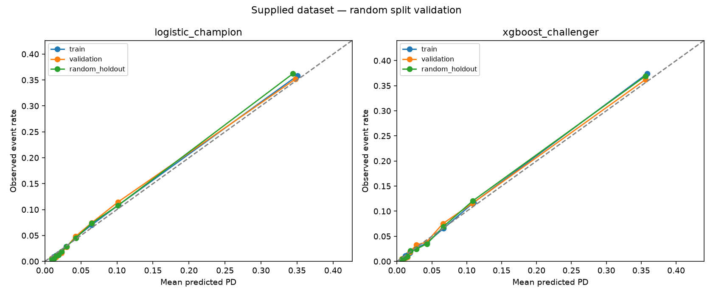

# Validation memo

Data status: **SUPPLIED DATA**. Generation seed: N/A (supplied CSV). Rows: 150,000.
This is a historical random-split assessment, not evidence of production readiness.

## Scope and independence

Metrics are recomputed from row-level predictions using a separate validation module.
Both champion and challenger are evaluated when enabled. This is implementation-level
independent checking, not an organizationally independent validation review.
Caps are fixed business rules. Medians, WOE bins, feature selection, and model parameters
are learned only from training observations, then frozen for validation and inference.
Split membership, medians, WOE tables, predictions, configuration and data hashes are exported.

## Discrimination and calibration

| model | split | auc | gini | ks | brier | calibration_intercept | calibration_slope |
| --- | --- | --- | --- | --- | --- | --- | --- |
| logistic_champion | train | 0.8511 | 0.7022 | 0.5459 | 0.0506 | 0.0004 | 1.0002 |
| logistic_champion | validation | 0.8531 | 0.7062 | 0.5469 | 0.0509 | 0.0038 | 0.9999 |
| logistic_champion | random_holdout | 0.8576 | 0.7153 | 0.5553 | 0.0505 | 0.0611 | 1.0238 |
| xgboost_challenger | train | 0.8682 | 0.7364 | 0.5806 | 0.0483 | 0.1271 | 1.0648 |
| xgboost_challenger | validation | 0.8639 | 0.7277 | 0.5692 | 0.0495 | 0.0629 | 1.0264 |
| xgboost_challenger | random_holdout | 0.8675 | 0.7350 | 0.5803 | 0.0487 | 0.1212 | 1.0587 |

AUC measures ranking; Gini = 2*AUC-1. KS is the maximum absolute separation of
event and non-event score CDFs. Brier and log loss assess probability accuracy.
Joint calibration regression has ideal intercept 0 and slope 1. Fit failures are
flagged in metrics.csv; a failed calibration fit must not be interpreted as a pass.
Reliability bands and mean-PD minus observed-rate gaps are exported separately.
These point estimates have no uncertainty intervals and should not be overinterpreted.
Training WOE uses training outcomes, so in-sample performance is optimistic.

Observed champion findings: validation AUC is **0.8531**;
random-holdout AUC is **0.8576** and random-holdout Gini is **0.7153**.
The training-to-random-holdout Gini drop is **-0.0130**
(configured review flag: **False**).
Random-holdout calibration intercept/slope are **0.0611 /
1.0238**; review their departure from 0/1 rather than
inferring stability from PSI alone. No statistical significance is asserted.

## Random holdout limitation

The configured split is 20% validation and
20% random holdout, with the remainder for training.
Both held-out partitions are stratified random samples of the same population.
There is no date-based separation, seasoning test, macroeconomic change, vintage analysis,
or genuine future observation. Low holdout PSI does **not** prove temporal stability.
The supplied data are assessed as a historical random holdout; this does not establish future-vintage performance or suitability for a new lending population.
A genuine OOT test requires dated applications and fully matured default outcomes,
with training cutoffs preceding evaluation vintages.

## Monitoring simulation

| scenario | psi | gini | gini_drop | psi_alert | performance_alert | calibration_alert |
| --- | --- | --- | --- | --- | --- | --- |
| unshifted_control | 0.0004 | 0.7153 | 0.0000 | False | False | False |
| covariate_shift_fixed_labels | 21.7116 | 0.5609 | 0.1544 | True | True | True |
| artificial_outcome_inversion | 0.0004 | -0.7153 | 1.4305 | False | True | True |

Monitoring experiments use the frozen logistic champion.
The shifted batch sets utilization to 1.5, multiplies imputed income by 0.35,
and adds four 90-day delinquencies before applying frozen preprocessing.
Labels stay fixed to isolate a controlled covariate stress; they are not new realized outcomes.
The outcome-inversion batch deliberately creates artificial labels (1-y), keeping features
fixed, solely to exercise the performance and calibration alert paths. It is not a forecast.
PSI uses fixed training-score quantile edges with smoothing. Gini drops are absolute
changes from the unshifted random holdout cohort. Calibration alerts use absolute mean-PD gaps.
Thresholds are illustrative project settings, not regulatory standards.
Expected PSI alarm triggered: **True**.
Expected Gini alarm triggered: **True**.

## Decision stress tests

| scenario | approval_rate | portfolio_expected_default_rate | approved_expected_default_rate | approved_observed_rate_fixed_labels |
| --- | --- | --- | --- | --- |
| baseline | 0.2684 | 0.0663 | 0.0121 | 0.0063 |
| income_x0.5 | 0.2156 | 0.0705 | 0.0125 | 0.0053 |
| income_x1.5 | 0.2934 | 0.0636 | 0.0118 | 0.0065 |
| late90_plus1 | 0.0000 | 0.1624 | N/A | N/A |
| late90_plus3 | 0.0000 | 0.1624 | N/A | N/A |
| income_down_late90_up | 0.0000 | 0.1726 | N/A | N/A |

Approval requires rounded, clipped score > 620; review cases are not counted as approvals.
All changes hold other fields fixed; income and DebtRatio are not economically reconciled.
Expected default rates are averages of model PDs, not observed stressed default rates.
The fixed-label approved rate changes only with selection into the approved portfolio.
No causal income or delinquency effect is identified, and there is no loss-given-default model.
Zero approvals produce N/A approved-portfolio rates rather than a misleading zero.
In this run, halving income changes approval from **26.84%**
to **21.56%**, and whole-portfolio expected default rate from
**6.63%** to **7.05%**.
The delinquency scenario adds one late payment to **every** holdout applicant,
not one applicant. Maximum score after this shock is **607**,
versus approval requiring > **620**. Minimum stressed PD is
**2.54%**, versus an approximate score-rounding approval PD boundary of
**1.61%**. Thus zero approvals, when observed,
follow from the fitted score distribution crossing a strict policy threshold.
The actual delinquency bins and diagnostic values are exported separately.
Additional delinquency increments can map to the same learned WOE bin, yielding identical
stress results; unselected variables also have no direct modeled effect. These are model limitations, not evidence that extra delinquencies
have no economic effect.

## Sign checks and implementation findings

| feature | perturbation | expected_pd_direction | mean_pd_change | violation_rate | unchanged_rate | selected |
| --- | --- | --- | --- | --- | --- | --- |
| MonthlyIncome | 1000.0000 | -1.0000 | -0.0010 | 0.0000 | 0.6736 | True |
| NumberOfTimes90DaysLate | 1.0000 | 1.0000 | 0.0961 | 0.0000 | 0.0544 | True |
| NumberOfTime30-59DaysPastDueNotWorse | 1.0000 | 1.0000 | 0.0351 | 0.0000 | 0.0529 | True |
| NumberOfTime60-89DaysPastDueNotWorse | 1.0000 | 1.0000 | 0.0563 | 0.0000 | 0.0495 | True |

WOE is log(event share / non-event share), so positive WOE coefficients are the
usual risk-consistent direction. Negative coefficients require multicollinearity,
selection and economic interpretation review, not automatic reversal.
Negative selected coefficient count: **1**.
Perturbation violations must be reviewed alongside the unchanged fraction: frozen bins
make local sensitivities stepwise, and an unselected variable can have no direct effect.
The baseline was corrected for whole-sample median leakage, inconsistent WOE interval
boundaries, minimum-value exclusion for discrete features, constant-score PSI handling, sparse-count quantile collapse,
and the sign of the intercept contribution in the scorecard points table.

## Python–SAS reconciliation

**PENDING — SAS is unavailable; no cross-platform agreement is claimed.**
The exported SAS program fits an unpenalized companion logistic model on the identical
training rows and precomputed WOE matrix. It models target=1, includes an intercept,
and uses no sampling weights, class weights, variable selection or standardization.
This avoids confusing SAS default maximum likelihood with the champion's L2 fit.
Run reconciliation/reconcile.sas, inspect its convergence/separation log, then use
reconcile.py to compare returned coefficients, row-level probabilities and Gini on all splits.
The comparator rejects duplicate/missing IDs, mismatched targets, split membership,
WOE columns, nonfinite probabilities or missing coefficient terms before testing tolerances.
Tolerance settings are in reconciliation/manifest.json. Numerical agreement cannot
replace SAS log review or establish economic/model validity.

## Recommended actions and disposition

- Investigate input drift and data quality when score PSI exceeds 0.1; review feature-level drift and sample composition.
- Escalate an absolute Gini drop over 0.05 after outcomes mature; assess uncertainty and cohort mix before changing policy.
- Investigate a mean-PD calibration gap over 0.03; recalibrate only on approved, representative development data.
- Review sign violations, negative WOE coefficients and approval/expected-risk changes with credit policy owners.
- Obtain a genuine dated evaluation cohort, confirm data provenance and target maturity, and complete actual SAS execution before seeking model approval.
- Add sample-size-dependent limits, confidence intervals, fairness/segment validation and realized-loss backtesting before deployment.

Disposition: **historical random-split validation; production approval and SAS reconciliation pending**.
